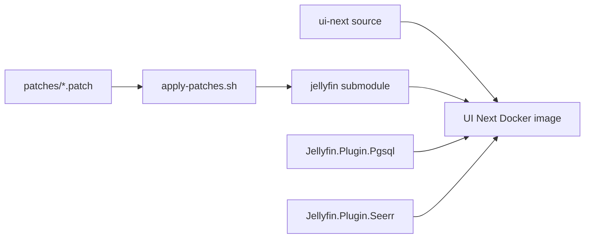

# Architecture

How this repository builds a PostgreSQL-backed Jellyfin image with UI Next as its web client.

## Repository map

| Path | Role |
|---|---|
| [`Jellyfin.Plugin.Pgsql/`](../Jellyfin.Plugin.Pgsql/) | PostgreSQL EF provider, migrations, query cache, fuzzy search, taste, Emby import, admin APIs, optional active-standby HA |
| [`Jellyfin.Plugin.Seerr/`](../Jellyfin.Plugin.Seerr/) | Seerr/Jellyseerr client plugin (search, request, parental filtering) |
| [`ui-next/`](../ui-next/) | Preact/Vite web client, tests, and static build served by the Docker image |
| [`jellyfin/`](../jellyfin/) | Upstream server git submodule; keep its working tree clean after patch work |
| [`patches/`](../patches/) | Server customizations as flat `*.patch` files |
| [`scripts/apply-patches.sh`](../scripts/apply-patches.sh) | Routes and applies patches by filename |
| [`scripts/rebase-patches.sh`](../scripts/rebase-patches.sh) | Replays the patch series onto a new Jellyfin tag and rewrites `patches/` |
| [`scripts/sync-jellyfin-migrations.sh`](../scripts/sync-jellyfin-migrations.sh) | Align server patches and plugin EF migrations with a Jellyfin release |
| [`scripts/start-dev.sh`](../scripts/start-dev.sh) | Local OIDC/RBAC stack via `docker-compose.dev.yaml` |
| [`docker/`](../docker/) | Production image build (Dockerfile, entrypoint, migrator) |

Agent-oriented rules (never commit submodule dirt, auth checklist, JSON casing) live in [`AGENTS.md`](../AGENTS.md).

## Patch routing and apply order

[`scripts/apply-patches.sh`](../scripts/apply-patches.sh) applies server patches from `patches/` to `jellyfin/`:

| Filename pattern | Applied to |
|---|---|
| `jellyfin_*.patch` or `jellyfin.patch` | `jellyfin/` |

Names beginning with `jellyfin_web` are rejected. The web submodule and its patch stack have been removed.

Patches are applied in byte-order lexicographic order (`LC_ALL=C sort`). Locale collation can change the order of filenames, so the script fixes the locale before sorting. Prefixes encode layering:

- Unprefixed thematic names apply in alphabetical order among themselves.
- `jellyfin_z_*` runs late so it can edit files already touched by earlier patches (HA leadership, Live TV RBAC allowlist, taste impressions).
- `jellyfin_zz_*` runs late (for example, person identity).
- `jellyfin_zzz_*` and later prefixes run after their dependencies (for example, by-name access, people queries, device playback options, and HLS lifecycle fixes).

Some patches document explicit prerequisites in a `#` preamble when apply order matters beyond lexicographic sort. Those comments are authoritative when refreshing patches.

When bumping Jellyfin tags, do **not** hand-edit hunk line numbers. Replay the series:

```bash
./scripts/rebase-patches.sh --from v12.0-rc6 --to v12.0-rc7
```

The sync script rebases the server patch series when the Jellyfin tag changes, then builds the four plugin and test projects individually in Release. EF design-time commands also specify Release so they use the installed SDK's compiler configuration.

That applies each patch as a commit on `--from`, `git rebase --onto` the new tag, and writes updated `patches/*.patch` files. Hunks that only fail because surrounding lines moved are merged automatically. Remaining **content** conflicts are reported (patch name + files) and must be resolved with `export-patch.sh`. SQLite `*ModelSnapshot.cs` conflicts are skipped by keeping the new upstream snapshot (this fork’s schema lives in plugin migrations). `sync-jellyfin-migrations.sh` runs this automatically when the target tag differs from [`.github/jellyfin-sync-state.json`](../.github/jellyfin-sync-state.json).

```bash
# Used by Docker / CI
./scripts/apply-patches.sh jellyfin

# After editing the submodule with existing patches applied
./scripts/export-patch.sh jellyfin_<name>.patch
```

The exporter snapshots changed file contents, rebuilds the baseline with preceding server patches, then diffs the restored edits against that baseline. It records the baseline with `git write-tree`, so export creates no submodule commits. Replaying `git diff HEAD` on that baseline would duplicate already-applied dependency hunks. The script resets `jellyfin/` to its pinned tag after export.

## Build composition

`ui-next/` builds a static site into `ui-next/dist/`. The Dockerfile's `ui-next` target is also the default target. It serves the bundle at `/web` by setting `JELLYFIN_WEB_DIR=/jellyfin/ui-next`. The standard Jellyfin-version and `latest` image tags both use this target.

At runtime, UI Next routes supported Android video playback to the official Jellyfin Android app's injected `window.NativePlayer` bridge before starting its own PlaybackInfo negotiation or session tracker. It prefers the companion `syncSession` handshake, where Android verifies the requested server and user before acknowledging readiness. Stock Android 2.7.3 lacks that method, so UI Next writes the current user and token in the legacy `jellyfin_credentials` shape and requests `/Sessions/Capabilities/Full`; Android's WebView client intercepts that route and updates its `ApiClient`. The legacy route has no readiness acknowledgement, so the compatibility path is best-effort until verified on the deployed app version. After a successful sync, Jellyfin Android opens its native ExoPlayer screen and owns playback reporting; the WebView remains underneath and becomes visible again when the native player closes. Hosts without an enabled bridge or a successful session sync use UI Next's HTML player. webOS also uses the HTML player path through `<video>`. For every HLS URL, the HTML player lazy-loads `hls.js` and checks `Hls.isSupported()` before considering native HLS. It uses native HLS only when HLS.js is unsupported, and reports a playback error if neither path is supported.

The `syncSession` readiness method is supplied by the companion Jellyfin Android change. Stock app releases without it use the intercepted capabilities route; custom wrappers still need their own session-sync contract.

Remote YouTube trailers use a separate UI Next player source and the authenticated plugin route `/Pgsql/Trailers/{videoId}/stream`. This path stays in the HTML player on every client, bypasses library `PlaybackInfo` negotiation and native handoff, and does not send library playback reports. The plugin resolves YouTube media with yt-dlp and relays progressive sources or remuxes separate tracks with ffmpeg.

## UI Next end-to-end tests

`ui-next/e2e/` runs Playwright Chromium against UI Next and a local fake Jellyfin HTTP server. The browser sends API requests to the app origin, and Vite forwards the configured Jellyfin paths to the fake server. The server generates deterministic PascalCase fixtures, serves the checked-in WebM and placeholder image, and records sanitized API requests. It writes only the method, path, and error type to stderr on internal failures. Vite 6 uses `server.proxy` as the default `preview.proxy`, so local dev and CI preview use the same proxy map. CI builds the static bundle, serves it with `vite preview`, and runs sign-in, browse, details, detail-actions, playback-report, profile-menu, and plugin-settings tests. A second Playwright project emulates a webOS user agent at 1920×1080 to exercise the TV layout and D-pad focus paths. The suite does not start Docker or PostgreSQL.



During `docker build` ([`docker/Dockerfile`](../docker/Dockerfile)):

1. The `jellyfin` server submodule is checked out at the pinned tag, and `scripts/apply-patches.sh` applies its server patches.
2. Docker builds UI Next, including its tests, then builds the patched server and packages the plugins.
3. The runtime stage copies the UI Next bundle to `/jellyfin/ui-next` and sets `JELLYFIN_WEB_DIR` to that path.
4. The entrypoint wires `POSTGRES_*`, optional Redis, and optional SSO environment variables. It can also run SQLite-to-PostgreSQL migration.

Push, release, scheduled, and manual Docker workflow events build `ui-next` and publish the Jellyfin-version and `latest` tags. The plugin build and test workflows also apply server patches.

**Migration sync and patches:** fork schema (playback activity, taste entities, people provider key, indexes, and other plugin-owned changes) belongs in dedicated plugin migrations authored with the patch. Sync does not use `Update_*` to capture patch schema. On each version bump it rebases server patches onto the new tag, applies them, builds the four plugin and test projects individually in Release, optionally generates `Update_*` when core SQLite migrations advance, then resets the server submodule.

## Plugin modules (high level)

Inside `Jellyfin.Plugin.Pgsql`:

| Area | Responsibility |
|---|---|
| `Database/` | Npgsql provider, connection string / timeout, backups |
| `Migrations/` | PostgreSQL EF migrations (synced from Jellyfin + fork entities) |
| `Query/` | Latest/Resume/NextUp cache and PG-optimised Latest, NextUp, and candidate-first Resume SQL |
| `Search/` | Trigram / franchise-oriented fuzzy search (`<%` / `jellyfin_word_similar` on GIN) |
| `Taste/` | Profile rebuild, scoring, recommendations |
| `Api/` | Taste, Emby import, user admin, plugin stats controllers |
| `Admin/EmbyImport/` | Emby SQLite userdata import pipeline |
| `Playback/` | Playback-reporting import helpers (where applicable) |

`Jellyfin.Plugin.Seerr` talks to an external Seerr/Jellyseerr instance (URL + API key in plugin config). UI Next uses it for search and Beyond Your Library.

### Candidate-first Resume selection

`CachingItemRepository` decorates both `GetItemList` and `GetItems`. For supported DatePlayed-descending Resume requests, `ResumeQueryFilter` creates an independent filter with core resumability disabled and alternate versions retained. The public `IItemQueryHelpers.TranslateQuery` supplies the actual library and access restrictions.

`PgResumeQuery` embeds that filter's ID projection using `PgQuerySqlBuilder`, preserving EF's typed parameters. Materialized progress and candidate CTEs select the small active set. Correlated key lookups keep unrelated videos out of item and permission scans. Version comparison precedes output restrictions, and totals precede paging. A permitted folder candidate triggers core fallback before paging.

`CachedItemLoader` loads the selected IDs with split collection queries and restores selection order. Counted pages use the selector directly; uncounted pages can reuse the existing Resume ID cache. The optimizer also runs when caching is disabled. This path is plugin-owned and adds no server patch. See the [README switch](../README.md#query-cache-and-optimisation-optional-experimental) and [fallback caveat](known-issues.md#operational-caveats-this-image).

## Migration sync (summary)

A scheduled workflow detects new Jellyfin releases, updates server and plugin references, rebases server patches onto that tag, verifies they apply, and opens a collaborator-only PR. Docker publish is blocked until sync state matches the target version; after merge, every push to `master` rebuilds and republishes the GHCR image for that pinned version. Failures open or update issues labeled `migration-sync-failure` (see [known issues](known-issues.md)).

`Update_*` PostgreSQL migrations are generated only when Jellyfin's SQLite migration set advances. Tag-only bumps update version references and the server submodule pointer, verify patches, and build the four plugin and test projects individually in Release, but skip EF. When an `Update_*` is needed, EF diffs the patched design-time model against the PostgreSQL snapshot. It does not copy SQLite migrations. The sync then applies PostgreSQL-specific fixes and validates against PostgreSQL. EF commands use Release configuration. Local sync starts the `postgres` service from `docker-compose.dev.yaml` if nothing is listening, before it changes references or generates a migration. CI uses the workflow PostgreSQL service.

Operator-facing sync and release steps: [README — Release flow](../README.md#release-flow).

## Submodule hygiene

- Do not commit modified files inside `jellyfin/`.
- Export server diffs to `patches/` and reset the submodule after editing.
- The `jellyfin/` pointer, plugin package references, and migration sync state track the same Jellyfin release.
